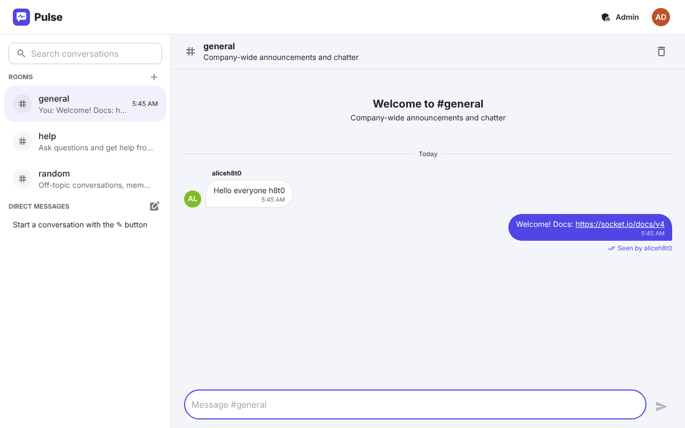
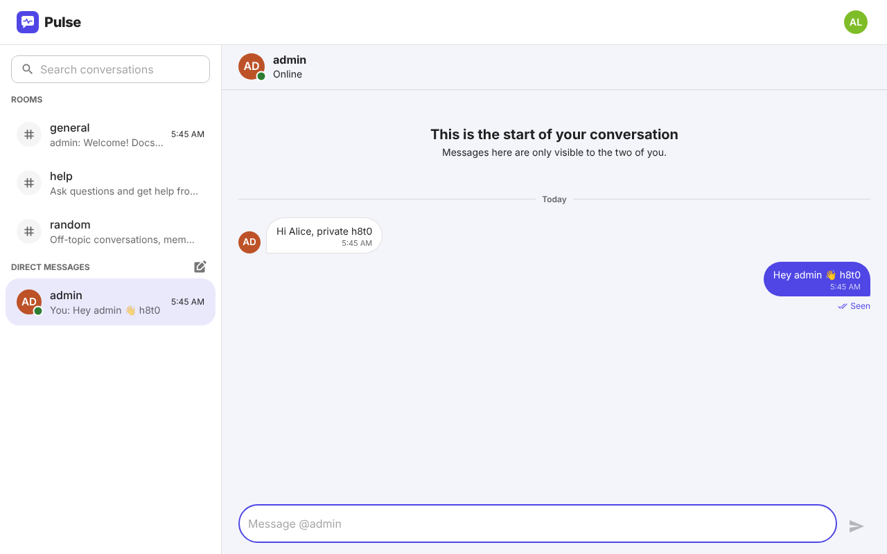
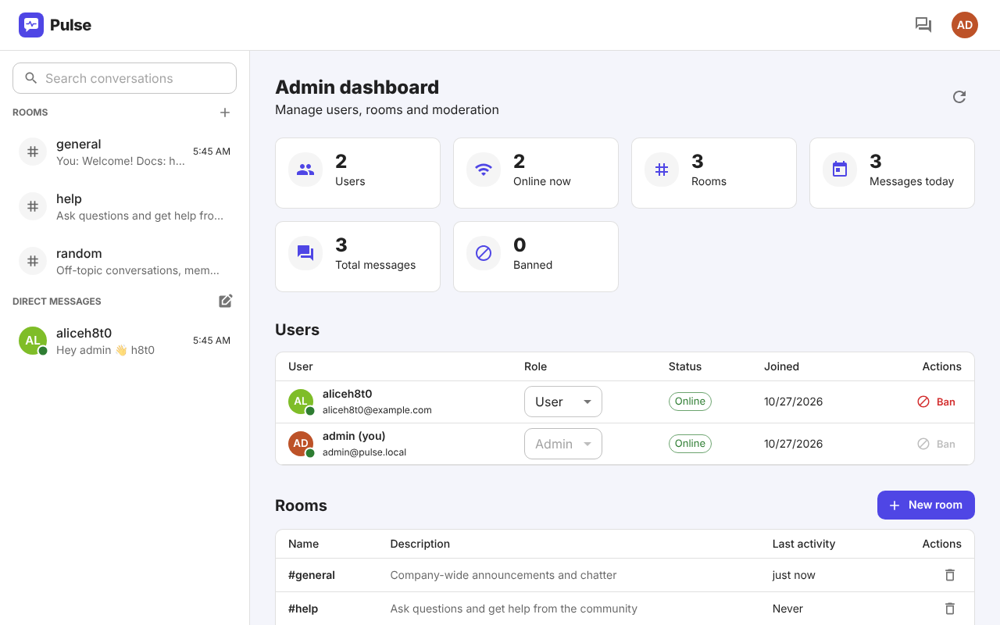
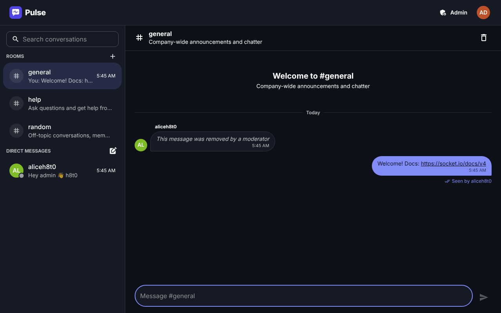
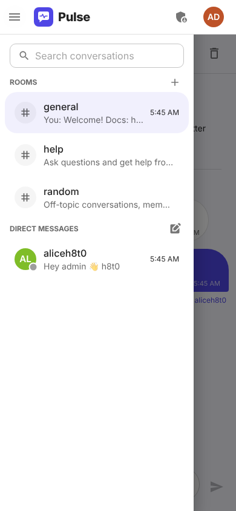
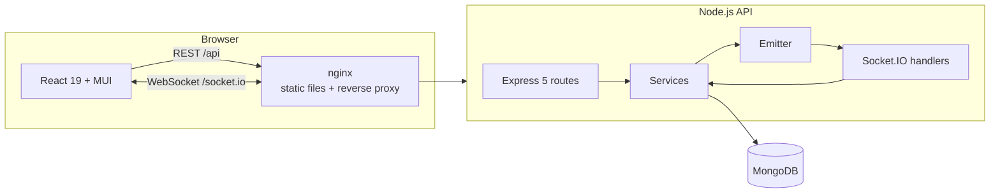

# Pulse – real-time MERN chat

A real-time chat application built with **MongoDB, Express, React and Node.js** in
**TypeScript**: public rooms, one-to-one direct messages, live typing indicators,
online presence, unread counts and "seen" receipts, with JWT authentication,
role-based administration and a one-command Docker deployment.



| Direct message with read receipt | Admin dashboard |
| --- | --- |
|  |  |

| Dark mode | Mobile |
| --- | --- |
|  |  |

## Features

**Chat**
- Public rooms (`#general`, `#random`, `#help` are created on first start) and private 1:1 direct messages
- Messages delivered instantly over WebSockets, with optimistic sending, delivery acknowledgements and retry
- Typing indicators ("alice is typing…") and live online / last-seen presence
- Unread counters per conversation, in the browser tab title and on the app icon
- Read receipts: "Seen" in DMs and "Seen by alice, bob" in rooms
- Infinite scroll through history (cursor pagination), date dividers, message grouping and clickable links
- Desktop notifications for messages in background conversations
- Light / dark / system theme and a responsive layout down to phone size

**Accounts and administration**
- Sign up / sign in with email or username; passwords hashed with bcrypt
- Short-lived JWT access tokens plus rotating refresh tokens, both in httpOnly cookies
- Forgot password: a single-use reset link (valid 30 minutes) is emailed over SMTP; resetting signs the
  account out on every device
- Two roles: **user** and **admin**
- Admins can create and delete rooms, remove any message, ban / unban users (which ends their sessions and
  disconnects them instantly), promote other admins and view live statistics

## Tech stack

| Layer | Technology |
| --- | --- |
| Database | MongoDB 8 with Mongoose 9 (aggregation pipelines, TTL / partial / collated indexes) |
| API | Node.js 22, Express 5, Socket.IO 4, Zod 4 validation, Helmet, rate limiting |
| Auth | JWT (jsonwebtoken) access tokens, opaque rotating refresh tokens, bcrypt |
| Client | React 19, React Router 8, Material UI 9, Vite 8, Socket.IO client |
| Language | TypeScript (strict) end to end, with a typed Socket.IO event contract |
| Testing | Vitest, Supertest, socket.io-client and mongodb-memory-server |
| Ops | Docker multi-stage builds, docker-compose, nginx reverse proxy, GitHub Actions CI |

## Advanced techniques used

**Backend**
- **Typed real-time contract**: `ServerToClientEvents` / `ClientToServerEvents` interfaces type every
  `emit`/`on` on both ends, and acknowledgements return `{ ok, data | error }`.
- **Socket.IO connection-state recovery** replays missed events after short disconnects; otherwise the client
  resyncs from the REST API.
- **Refresh-token rotation**: refresh tokens are random, stored only as SHA-256 hashes, and swapped on every use
  with a single atomic MongoDB *update pipeline*. The previous token stays valid for 30 s, so two tabs refreshing
  at the same moment don't sign each other out. Sessions expire through a **TTL index**.
- **Immediate revocation**: every request re-reads the user, so bans and role changes take effect at once.
  Banning also deletes all of the user's sessions and calls `disconnectSockets()`.
- **Unread counts and last-message previews** are computed in MongoDB with aggregation pipelines
  (`$match` → `$group`), not in application code.
- **Indexes**: partial unique indexes (one DM per pair of users, unique room names), case-insensitive
  usernames via collation, and compound indexes for cursor pagination.
- **Security**: httpOnly + `SameSite=Strict` cookies, Helmet headers, Zod validation on every input,
  login / registration rate limiting, a per-socket message rate limit, and logins that always run a bcrypt
  comparison, so response timing doesn't reveal which accounts exist.
- Shared service layer: the REST endpoint and the socket handler send messages through the same function.
- Graceful shutdown, health checks and environment validation on startup.

**Frontend**
- **React 19**: `use()`, context-as-provider, `useActionState` form actions, `useDeferredValue`,
  `lazy()` + `Suspense` code splitting (the admin page is a separate chunk) and vendor chunk splitting.
- Chat state lives in a pure **reducer** with separate state / actions contexts, which avoids needless re-renders.
- **Browser APIs**: IntersectionObserver (infinite scroll), BroadcastChannel (sign-in / sign-out syncs across tabs),
  Notifications, Badging (`navigator.setAppBadge`), Page Visibility (read receipts only while the tab is visible),
  `Intl.RelativeTimeFormat` / `DateTimeFormat`, `sessionStorage` drafts per conversation, and `100dvh` layout.
- **Silent token refresh**: concurrent 401 responses share one refresh request (single-flight), then retry.
  The socket also reconnects after a refresh.
- Material UI with **CSS-variable colour schemes** (no flash when switching theme; the choice is persisted).

## Architecture



A message sent from the composer goes through these steps:

1. It appears in the UI immediately as an optimistic message.
2. The client emits `message:send` and waits for an acknowledgement.
3. The server validates the message, checks access, stores it and broadcasts `message:new` to the conversation's room.
4. The acknowledgement swaps the optimistic copy for the stored message.
5. Recipients who have the conversation open send `conversation:read`, which updates the sender's "Seen" marker live.

## Getting started

### Option 1: Docker (everything in one command)

Requires Docker with Compose v2.

```bash
cp .env.example .env     # then set JWT_ACCESS_SECRET to a long random string
docker compose up --build
```

Open **http://localhost:8080** and sign in as the admin from `.env` (default `admin` / `admin12345`), or create a
new account. To try the real-time features, open a second browser (or a private window) as another user.

### Option 2: Local development (hot reload)

Requires Node.js ≥ 22 and a MongoDB instance on `localhost:27017`.

```bash
npm run install:all                  # installs root, server and client dependencies
npm run db:dev                       # optional: starts MongoDB in Docker (docker-compose.dev.yml)
cp server/.env.example server/.env   # adjust if needed
npm run dev                          # API on :4000, Vite on :5173 (proxies /api and /socket.io)
```

Open **http://localhost:5173**.

### Password-reset emails

Reset links are sent through any SMTP server: set `SMTP_HOST`, `SMTP_PORT`, `SMTP_USER`, `SMTP_PASS` and
`MAIL_FROM` in `.env` (for Gmail: `smtp.gmail.com`, port `587`, and an
[app password](https://myaccount.google.com/apppasswords)). Without `SMTP_HOST`, nothing is sent and the
link is printed to the server log instead (`docker compose logs server`), which is enough for local testing.

### Running it on the web

The project is live at **https://pulse-chat-bay.vercel.app** (app on Vercel, API on AWS EC2, data in
MongoDB Atlas). See [`deploy/aws/README.md`](deploy/aws/README.md) for how that deployment is set up and
maintained.

To self-host on a single server instead:

The same Docker setup runs on any server or VPS with Docker installed (e.g. DigitalOcean, AWS Lightsail,
Azure, a university server):

1. Point a domain at the server and put HTTPS in front of port 8080 (e.g. Caddy, or nginx with Let's Encrypt).
2. In `.env` set `APP_URL=https://your-domain`, `COOKIE_SECURE=true`, a strong `JWT_ACCESS_SECRET` and
   `ADMIN_PASSWORD`, plus the SMTP settings so reset emails actually arrive.
3. Run `docker compose up -d --build`.

### Useful scripts (from the repository root)

| Command | Description |
| --- | --- |
| `npm run dev` | Run the API and client with hot reload |
| `npm test` | Run the backend test suite |
| `npm run typecheck` | Type-check the server and client |
| `npm run build` | Build both packages for production |

## Configuration

Server environment variables (validated with Zod on startup):

| Variable | Default | Description |
| --- | --- | --- |
| `JWT_ACCESS_SECRET` | – (required) | Secret used to sign access tokens (≥ 16 chars) |
| `MONGO_URI` | `mongodb://127.0.0.1:27017/chat` | MongoDB connection string |
| `PORT` | `4000` | API port |
| `CLIENT_ORIGIN` | `http://localhost:5173` | Allowed CORS origin(s), comma separated |
| `ACCESS_TOKEN_TTL_SECONDS` | `900` | Access token lifetime (15 min) |
| `REFRESH_TOKEN_TTL_SECONDS` | `604800` | Refresh session lifetime (7 days, sliding) |
| `BCRYPT_ROUNDS` | `12` | Password hashing cost |
| `COOKIE_SECURE` | `true` in production | Set the `Secure` flag on cookies (requires HTTPS) |
| `TRUST_PROXY` | `0` | Number of reverse proxies in front of the API |
| `ADMIN_USERNAME` / `ADMIN_EMAIL` / `ADMIN_PASSWORD` | – | Admin account created on startup if missing |
| `APP_URL` | first `CLIENT_ORIGIN` | Public URL of the app, used in password-reset links |
| `PASSWORD_RESET_TTL_MINUTES` | `30` | How long a reset link stays valid |
| `SMTP_HOST` / `SMTP_PORT` / `SMTP_USER` / `SMTP_PASS` | – / `587` | Outgoing mail server. Without `SMTP_HOST`, reset emails are printed to the server log |
| `SMTP_SECURE` | `true` on port 465 | Use TLS from the start of the connection |
| `MAIL_FROM` | `Pulse Chat <no-reply@pulse.local>` | Sender of outgoing email |

## REST API

All routes are under `/api`. Errors use the shape `{ "error": string, "details"?: [{ path, message }] }`.

| Method | Route | Access | Description |
| --- | --- | --- | --- |
| POST | `/auth/register` | public | Create an account and start a session |
| POST | `/auth/login` | public | Sign in with `login` (email or username) and `password` |
| POST | `/auth/refresh` | refresh cookie | Rotate the refresh token, issue a new access token |
| POST | `/auth/logout` | public | Revoke the session and clear cookies |
| GET | `/auth/me` | user | Current account |
| POST | `/auth/forgot-password` | public | Email a reset link (same response whether or not the account exists) |
| POST | `/auth/reset-password` | public | Set a new password with `token` from the link; revokes all sessions |
| GET | `/users?q=` | user | Search people to message (online first) |
| GET | `/conversations` | user | Rooms and DMs with last message and unread count |
| POST | `/conversations/rooms` | admin | Create a room |
| DELETE | `/conversations/:id` | admin | Delete a room and its history |
| POST | `/conversations/dm` | user | Open (or create) the DM with `userId` |
| GET | `/conversations/:id/messages?before=&limit=` | participant | Cursor-paginated history |
| POST | `/conversations/:id/messages` | participant | Send a message (REST alternative to the socket) |
| POST | `/conversations/:id/read` | participant | Mark as read |
| GET | `/conversations/:id/receipts` | participant | Read receipts |
| DELETE | `/messages/:id` | admin | Remove a message |
| GET | `/admin/stats` | admin | Usage statistics |
| GET | `/admin/users` | admin | All accounts |
| PATCH | `/admin/users/:id` | admin | Change `role` and/or `isBanned` |
| GET | `/health` | public | Liveness / database status |

## Socket.IO events

The handshake is authenticated with the access-token cookie. On connect, each socket joins `user:<id>` and one
`conv:<id>` room for every conversation it can access.

| Direction | Event | Payload |
| --- | --- | --- |
| client → server | `message:send` (ack) | `{ conversationId, body }` → `{ ok, data: Message }` |
| client → server | `typing` | `{ conversationId, isTyping }` |
| client → server | `conversation:read` (ack) | `{ conversationId }` |
| server → client | `message:new` | `Message` |
| server → client | `message:deleted` | `{ conversationId, messageId }` |
| server → client | `typing` | `{ conversationId, user, isTyping }` |
| server → client | `presence` | `{ userId, online, lastSeen }` |
| server → client | `read:update` | `{ conversationId, userId, username, lastReadAt }` |
| server → client | `conversation:new` / `conversation:deleted` | `Conversation` / `{ conversationId }` |
| server → client | `session:revoked` | `{ reason }` (e.g. banned) |

## Testing

```bash
npm test
```

44 backend tests run against an in-memory MongoDB and cover:

- registration and login validation
- refresh-token rotation and its grace period
- logout revocation
- forgot / reset password: no account enumeration, hashed single-use tokens, expiry, sign-out everywhere
- room permissions
- DM privacy and de-duplication
- cursor pagination
- unread counts and read receipts
- moderation, bans and role changes
- the real-time layer, through actual Socket.IO clients: message delivery, acknowledgements, typing, presence,
  receipts, DM subscription and forced disconnect on ban

CI (`.github/workflows/ci.yml`) type-checks, tests and builds both packages on every push and pull request.

## Project structure

```
├── docker-compose.yml          # mongo + server + client (nginx)
├── docker-compose.dev.yml      # MongoDB only, for local development
├── server/
│   ├── src/
│   │   ├── config/env.ts       # Zod-validated environment
│   │   ├── models/             # User, Session, Conversation, Message, ReadState, PasswordReset
│   │   ├── services/           # tokens, mailer, password reset, conversations, messages, reads
│   │   ├── routes/             # auth, users, conversations, messages, admin
│   │   ├── middleware/         # auth/roles, errors, rate limiting
│   │   ├── socket/             # typed events, handlers, presence, emitter
│   │   ├── app.ts / server.ts  # Express app + HTTP/Socket.IO server factories
│   │   └── index.ts            # bootstrap, listen, graceful shutdown
│   └── tests/                  # Vitest + Supertest + Socket.IO client
└── client/
    ├── nginx.conf              # SPA hosting + API/WebSocket reverse proxy
    └── src/
        ├── auth/               # AuthContext (cross-tab sync), route guards
        ├── chat/               # ChatContext (socket lifecycle), reducer
        ├── components/         # Sidebar, MessageList, Composer, dialogs, …
        ├── pages/              # Login, Register, Forgot/Reset password, Chat, Admin (lazy), Error
        └── lib/                # API client, socket, formatting, notifications
```

## Notes and limitations

- Presence is kept in memory, so the API runs as a single instance. Scaling out would need the
  Socket.IO Redis adapter and a shared presence store.
- Over plain HTTP (`localhost`) cookies are sent without the `Secure` flag. Set `COOKIE_SECURE=true` behind HTTPS.
